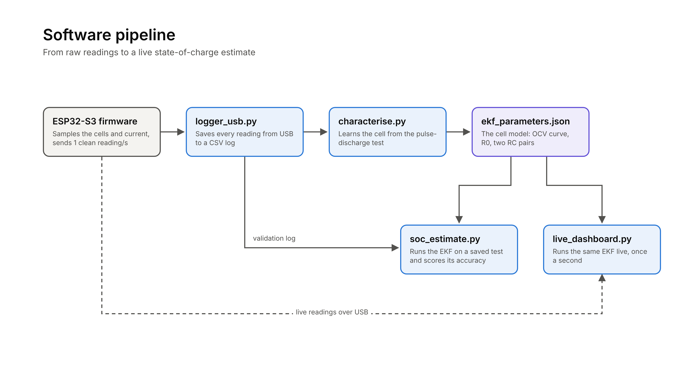
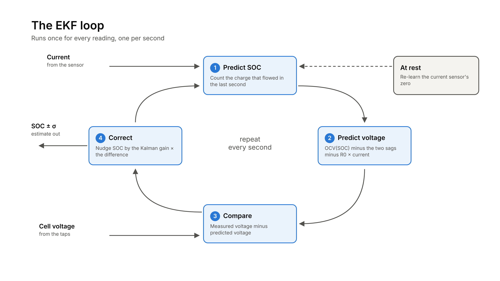
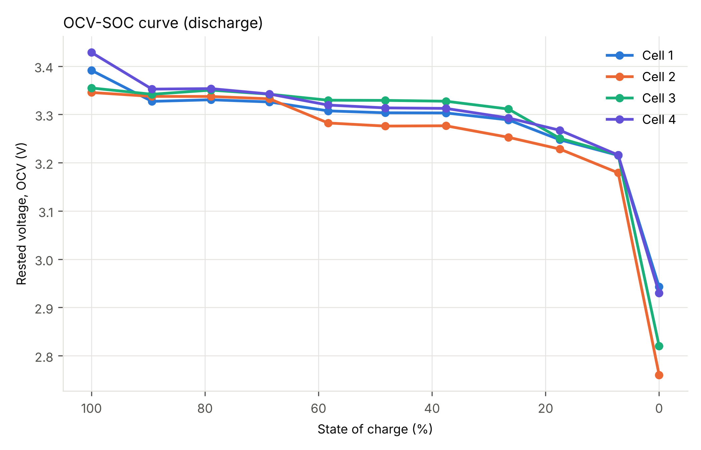
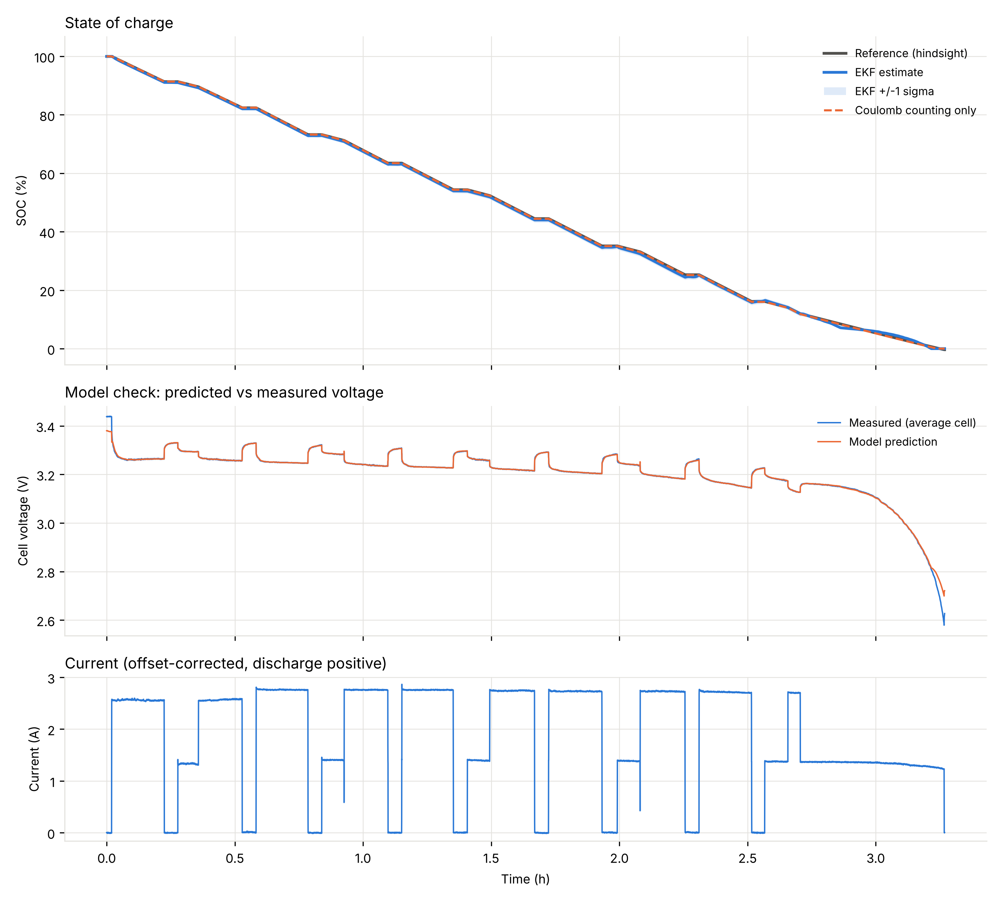

# Live SOC Estimation for a 4S LFP Battery Pack

A battery monitor for a four-cell LFP pack that estimates state of charge (SOC) live, using an extended Kalman filter (EKF) running on a cell model measured from the pack itself.

In validation over a full 3.3-hour discharge, the estimate stayed within **0.49% RMS** of the true SOC, with a worst-case error of **1.3%**.

**Demo video:** [link]  ·  **Full write-up:** [link]



## Key results

| Measure | Result |
|---|---|
| SOC error, typical (RMS) | **0.49%** |
| SOC error, worst case | **1.3%** |
| SOC error in the flat zone (30–80%) | 0.45% |
| Capacity: characterisation vs validation | 6.086 Ah vs 6.108 Ah (0.4% apart) |
| Internal resistance R0 (mean cell) | about 16 mΩ |
| RC time constants | about 35 s and about 17 min |

Accuracy is measured against a hindsight reference: the test starts full, and the charge removed is integrated with the current sensor's offset re-measured at every rest.

## Hardware

| Part | Details |
|---|---|
| Pack | 4S LFP, IFR32650 cells, 12.8 V nominal, 6 Ah rated, with its own BMS |
| Microcontroller | ESP32-S3, WiFi off, one reading per second over USB |
| Cell voltages | Balance taps through resistor dividers into GPIO 7, 6, 5, 4 (ADC1) |
| Current | ACS712 hall-effect sensor through a divider into GPIO 8 (ADC1) |
| Load | Switchable bulb load, about 1.4 A or 2.7 A |

The firmware averages about 2,000 current samples and 500 samples per cell every second (time average for current, 10% trimmed mean for voltages, with a dummy read after each ADC pin switch).

## How it works

1. **Characterise the cell.** A 10-step pulse-discharge test (about 2.6 A for 14 minutes, then an hour of rest, until the BMS cuts off) gives the capacity, the OCV–SOC curve, R0 at each SOC and a 2-RC fit of the voltage recovery.
2. **Estimate SOC.** The EKF tracks three states (SOC and two RC sag voltages). Every second it predicts SOC from the current, predicts the voltage the cell should show, compares it with the measured voltage and corrects the estimate by the Kalman gain. At rest it also re-learns the current sensor's zero.
3. **Validate.** A separate discharge with a different load pattern is scored against the hindsight reference.







## Limitations

- Between about 30% and 80% the LFP voltage changes by about 1 mV per 1% SOC, so a wrong SOC there is corrected slowly. Started 25% too high in that zone, the error lasts until about 10% SOC.
- From a known start, careful coulomb counting does as well. The EKF's value is recovering from a wrong or unknown start.
- One average-cell model (no per-cell SOC), no temperature compensation yet, discharge-only OCV (no hysteresis), one pack and one validation run.

## Repository layout

```
├── firmware/logging_firmware_usb/   ESP32-S3 firmware (Arduino)
├── logger_usb.py                    logs the ESP32's readings to CSV
├── characterise.py                  builds the cell model from a pulse-discharge log
├── ekf_parameters.json              the cell model used by both estimators
├── soc_estimate.py                  runs the EKF on a saved log and scores it
├── live_dashboard.py                runs the same EKF live, or replays a log
├── data/                            characterisation and validation logs
│   └── experiments/                 calibration, noise and earlier test logs
├── results/                         plots and summaries
└── extras/                          WiFi logger, noise analysis and other early scripts
```

## How to run

Needs Python 3 and the Arduino IDE with ESP32 support.

```bash
pip3 install -r requirements.txt

# Log a test over USB (close the Arduino Serial Monitor first; Ctrl+C to stop)
python3 logger_usb.py my_test

# Build the cell model from the pulse-discharge log
python3 characterise.py data/20261030_124828_characterisation_v3.csv characterisation_results

# Run the EKF on the validation log and score its accuracy
python3 soc_estimate.py data/20261102_163730_validation_v2.csv --reference-full

# Live dashboard from the pack
python3 live_dashboard.py --port /dev/cu.usbmodem101

# Replay a scored run, sped up, with a deliberately wrong start
python3 live_dashboard.py --replay data/20261102_163730_validation_v2_soc.csv --speed 600 --soc0 0.75
```

## Next steps

- Reset SOC at full charge, add OCV points from 70–100%, model hysteresis, per-cell SOC, working thermistors
- Run the EKF on the ESP32 itself
- An AI layer for battery health, fault detection and predictive maintenance

---

Built by Meet Deore.
